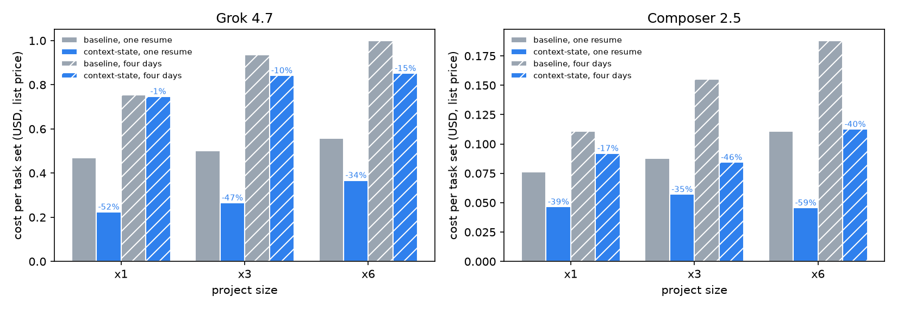

# No Need Long Context Skills

[中文](README.md) | English

Cursor Agent Skills that keep agent context short on long-running projects. Based on Belcak et al., ["You don't need long context"](https://arxiv.org/abs/2611.05306) (2026).

Long-running projects, such as experiments that span several days and many chats, no longer depend on re-reading the whole repository. Each workstream keeps a `STATE.md` of about 4000 characters as its compressed state, and the full history goes into an append-only `LEDGER.md`. A new chat reads one STATE and retrieves everything else on demand.

## Measured results

On a synthetic multi-day research project, the Cursor SDK compared two conditions: baseline is a plain `AGENTS.md`, and context-state is the same project with this skill installed and a first STATE written. Two models, three project sizes, and 3 repetitions per task gave 294 runs in total. Costs are converted at Cursor list prices.

- When a new chat takes over the work, context-state saves money at every size: 34% to 52% with Grok 4.7, and 35% to 59% with Composer 2.5.
- When work moves forward over four days with a new chat each day, the saving grows with project size: at 6× size, Grok 4.7 saves 15% and Composer 2.5 saves 40%. On the smallest project, Grok 4.7 only breaks even.
- Accuracy is almost unchanged: under both conditions nearly all key facts are correct, and context-state missed one fact (Grok 4.7, 3× size).
- The first STATE is a one-time cost: $0.23 to $0.81 with Grok 4.7 and $0.07 to $0.13 with Composer 2.5, repaid after about 5 to 14 resumes.



| Size | Scenario | Grok 4.7: baseline → context-state | Saved | Composer 2.5: baseline → context-state | Saved |
|---|---|---|---|---|---|
| 1× | New chat takes over (4 tasks) | $0.469 → $0.225 | 52% | $0.076 → $0.047 | 39% |
| 3× | New chat takes over (4 tasks) | $0.500 → $0.266 | 47% | $0.088 → $0.057 | 35% |
| 6× | New chat takes over (4 tasks) | $0.557 → $0.368 | 34% | $0.111 → $0.046 | 59% |
| 1× | Four days in a row | $0.755 → $0.747 | 1% | $0.111 → $0.092 | 17% |
| 3× | Four days in a row | $0.935 → $0.842 | 10% | $0.155 → $0.084 | 46% |
| 6× | Four days in a row | $1.000 → $0.852 | 15% | $0.188 → $0.113 | 40% |

Takeover tasks whose answers are scattered across several files save the most, 50% to 75%; tasks whose answer sits in one file roughly break even. On days that do new work, context-state also has to keep records, so those days do not save; the savings come from the takeovers that follow. Per-task means and standard deviations, token counts, the other figures, and the test method are in [`benchmark/results/summary.md`](benchmark/results/summary.md) and [`benchmark/README.en.md`](benchmark/README.en.md).

## Skills

| Skill | Purpose |
|---|---|
| [`context-state`](no-need-long-context/skills/context-state/SKILL.md) | Initialize a project, write a first STATE from existing documents, resume in a new chat, update state after events, hand off |

The evidence and the source of each rule are in [`reference.md`](no-need-long-context/skills/context-state/reference.md).

## Layout

```text
.cursor-plugin/marketplace.json   lists the plugin for Cursor's GitHub import and marketplace
no-need-long-context/             the plugin
  .cursor-plugin/plugin.json      plugin manifest
  skills/context-state/
    SKILL.md            workflow and rules the agent reads
    reference.md        evidence from the paper (read on demand)
    templates/{zh,en}/  AGENTS.md rules block, STATE and LEDGER templates
    scripts/init.py     initialize a target repository (safe to rerun)
    scripts/check.py    check STATE for size, staleness, and missing index entries
  hooks/                reminder hook (see below)
tools/validate_skill.py   validate the marketplace manifest, plugin manifest, and SKILL.md
tools/dev_install.sh      symlink the skills into ~/.cursor/skills/
tests/                    unit tests for the scripts
benchmark/                token and cost benchmark
```

Cursor's importer needs each plugin in its own directory, with `source` in `marketplace.json` set to the bare directory name. A plugin at the repository root (`"source": "."`) is rejected without an error.

## Installation

Pick one of three ways:

| Way | Command or action | Suited to |
|---|---|---|
| Personal skill (for development) | `tools/dev_install.sh`: symlinks into `~/.cursor/skills/`, so repository changes apply at once | Your own machine |
| Local plugin | `tools/plugin_local_install.sh`: copies into `~/.cursor/plugins/local/`, then run Developer: Reload Window | Testing the plugin before release |
| Import from GitHub | Customize → From GitHub Repository, enter this repository's URL (uses `.cursor-plugin/marketplace.json`) | Other people and other machines |

Do not install the same skill both of the first two ways, or it will appear twice.

Then, in a chat in any project, say "initialize this project with context-state", or run:

```bash
S=~/.cursor/skills/context-state/scripts
python3 $S/init.py --root . --scan                                   # list candidate workstreams
python3 $S/init.py --root . --lang en --workstream exp/a=ExperimentA --dry-run
python3 $S/init.py --root . --lang en --workstream exp/a=ExperimentA
python3 $S/check.py --root .
```

`init.py` manages only the content between `<!-- context-state:begin -->` and `<!-- context-state:end -->` in `AGENTS.md` and leaves the rest unchanged; rerunning it does not insert the block twice. The first `STATE.md` is not generated by the script: the agent reads the existing material once and fills it in (Workflow B in the skill).

## Reminder hook

At the end of each chat turn, the hook in `no-need-long-context/hooks/` checks whether the agent edited files under a workstream whose `STATE.md` is older than those edits. If so, it sends one follow-up message asking for LEDGER and STATE to be updated per Workflow D. It does not remind for workstreams without a `STATE.md`, for turns that only changed STATE or LEDGER, or for aborted turns, and it reminds at most once per turn. When the hook fails it does nothing and never blocks the chat.

- When installed as a plugin, the hook comes with it.
- When only the skill is installed with `tools/dev_install.sh`, the hook is not active. If you want it, add two entries to `~/.cursor/hooks.json`, replacing `${CURSOR_PLUGIN_ROOT}` with the absolute path of the plugin directory:

```json
{
  "version": 1,
  "hooks": {
    "afterFileEdit": [{ "command": "python3 /path/to/No_Need_Long_Context_Skills/no-need-long-context/hooks/context_state_hook.py record" }],
    "stop": [{ "command": "python3 /path/to/No_Need_Long_Context_Skills/no-need-long-context/hooks/context_state_hook.py stop", "loop_limit": 1 }]
  }
}
```

The hook sees only files the agent changed through edit tools, not files changed by shell commands or by submitted jobs.

## Development and testing

```bash
python3 tools/validate_skill.py
python3 -m unittest discover -s tests -v
```

Only the Python 3.10+ standard library is needed. CI runs the same two commands on 3.10 and 3.13. `validate_skill.py` also checks the manifests: each `source` in `.cursor-plugin/marketplace.json` is a bare directory name that holds a plugin of the same name; in `no-need-long-context/.cursor-plugin/plugin.json` the name is lowercase kebab-case, paths are relative and exist, and `CHANGELOG.md` has an entry for the current version.

## Release

1. Change `version` in `no-need-long-context/.cursor-plugin/plugin.json`, add an entry for the same version in `CHANGELOG.md`, and pass the two checks above.
2. Test as a local plugin (`tools/plugin_local_install.sh`) and confirm that `context-state` appears in Customize.
3. Commit, tag, and push: `git tag vX.Y.Z && git push origin main --tags`.
4. Channels:
   - **GitHub import**: available as soon as it is pushed, with no review. Customize → From GitHub Repository adds the repository as a source; then find `No Need Long Context` in the list and install it.
   - **Team marketplace** (Teams / Enterprise): Dashboard → Plugins & MCPs → Add Marketplace → Import from Repo. Turn on Auto Refresh to follow repository updates automatically.
   - **Public marketplace**: submit the public repository URL at [cursor.com/marketplace/publish](https://cursor.com/marketplace/publish). Every version is reviewed by hand, and after approval it does not follow repository updates automatically.

## License

MIT
