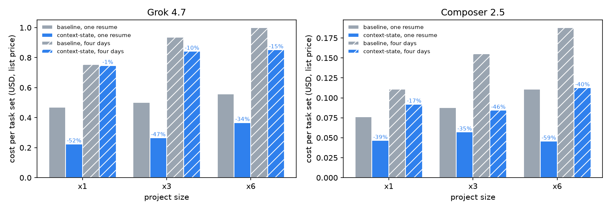

# No Need Long Context Skills

中文 | [English](README.en.md)

Cursor Agent Skills that keep agent context short on long-running projects. Based on Belcak et al., ["You don't need long context"](https://arxiv.org/abs/2611.05306) (2026).

让长周期项目（实验跨几天、跨多个对话）不再依赖整库重读：每条工作线维护一份约 4000 字符的 `STATE.md` 作为压缩状态，完整历史写进只追加的 `LEDGER.md`，新对话只读一份 STATE，其余内容按需检索。

## 实测效果

在一个合成的多日研究项目上，用 Cursor SDK 对比两种条件：baseline 是普通的 `AGENTS.md`，context-state 是装好本 Skill 并写好首版 STATE 的同一个项目。测了两个模型、三档项目规模，每个任务重复 3 次，共 294 次运行，费用按 Cursor 标价换算。

- 新对话接手时，context-state 在所有规模下都省钱：Grok 4.7 省 34% 到 52%，Composer 2.5 省 35% 到 59%。
- 连续四天、每天一个新对话推进工作时，节省随项目规模增长：在 6 倍规模下，Grok 4.7 省 15%，Composer 2.5 省 40%。最小的项目里，Grok 4.7 只是持平。
- 答对率几乎没有变化：两种条件下关键事实都几乎全对，context-state 只漏了一个事实（Grok 4.7，3 倍规模）。
- 首版 STATE 是一次性成本：Grok 4.7 花 $0.23 到 $0.81，Composer 2.5 花 $0.07 到 $0.13，约 5 到 14 次接手后回本。



| 规模 | 场景 | Grok 4.7：baseline → context-state | 省下 | Composer 2.5：baseline → context-state | 省下 |
|---|---|---|---|---|---|
| 1 倍 | 新对话接手（4 个任务） | $0.469 → $0.225 | 52% | $0.076 → $0.047 | 39% |
| 3 倍 | 新对话接手（4 个任务） | $0.500 → $0.266 | 47% | $0.088 → $0.057 | 35% |
| 6 倍 | 新对话接手（4 个任务） | $0.557 → $0.368 | 34% | $0.111 → $0.046 | 59% |
| 1 倍 | 连续四天 | $0.755 → $0.747 | 1% | $0.111 → $0.092 | 17% |
| 3 倍 | 连续四天 | $0.935 → $0.842 | 10% | $0.155 → $0.084 | 46% |
| 6 倍 | 连续四天 | $1.000 → $0.852 | 15% | $0.188 → $0.113 | 40% |

答案分散在多个文件里的接手任务省得最多，达 50% 到 75%；答案就在一个文件里的任务基本持平。每天要做新工作的那几天，context-state 还要额外记录，所以不省；省下的钱主要来自之后的接手。逐任务的均值与标准差、token 用量、其余图表和测试方法见 [`benchmark/results/summary.md`](benchmark/results/summary.md) 与 [`benchmark/README.md`](benchmark/README.md)。

## Skills

| Skill | 作用 |
|---|---|
| [`context-state`](skills/context-state/SKILL.md) | 初始化项目、从已有文档生成首版 STATE、新对话接手、事件触发的状态更新、交接 |

依据与各条规则的出处见 [`skills/context-state/reference.md`](skills/context-state/reference.md)。

## 目录

```text
skills/context-state/
  SKILL.md            agent 读的流程与规则
  reference.md        论文依据（按需读）
  templates/{zh,en}/  AGENTS.md 规则块、STATE、LEDGER 模板
  scripts/init.py     初始化目标仓库（可重复执行）
  scripts/check.py    检查 STATE 是否超长、过期、未入索引
hooks/                    提醒钩子（见下文）
tools/validate_skill.py   校验 SKILL.md 与插件描述文件
tools/dev_install.sh      把 skills/ 软链到 ~/.cursor/skills/
tests/                    脚本的单元测试
```

## 安装

三种方式，任选其一：

| 方式 | 命令或操作 | 适合 |
|---|---|---|
| 个人 Skill（开发时用） | `tools/dev_install.sh`：软链到 `~/.cursor/skills/`，改了仓库立即生效 | 自己的机器 |
| 本地插件 | `tools/plugin_local_install.sh`：复制到 `~/.cursor/plugins/local/`，然后执行 Developer: Reload Window | 发布前测试插件 |
| 从 GitHub 导入 | Customize → From GitHub Repository，填本仓库地址（依赖 `.cursor-plugin/marketplace.json`） | 其他人、其他机器 |

同一 Skill 不要同时用前两种方式装，否则会出现两份。

之后在任意项目的对话里说"用 context-state 初始化这个项目"，或直接运行：

```bash
S=~/.cursor/skills/context-state/scripts
python3 $S/init.py --root . --scan                                   # 列出候选工作线
python3 $S/init.py --root . --lang zh --workstream exp/a=实验A --dry-run
python3 $S/init.py --root . --lang zh --workstream exp/a=实验A
python3 $S/check.py --root .
```

`init.py` 只管理 `AGENTS.md` 中 `<!-- context-state:begin -->` 与 `<!-- context-state:end -->` 之间的内容，其余内容保持不变；重复运行不会重复插入。首版 `STATE.md` 不由脚本生成，需要 agent 读一遍已有材料后填写（Skill 中的 Workflow B）。

## 提醒钩子

`hooks/` 在每轮对话结束时检查：本轮 agent 编辑过某条工作线下的文件，而该工作线的 `STATE.md` 比这些编辑旧，就发一条后续消息，要求按 Workflow D 补写 LEDGER 和 STATE。还没有 `STATE.md` 的工作线、只改 STATE 或 LEDGER、被中止的轮次，都不提醒；每轮最多提醒一次。钩子出错时什么都不做，不会阻断对话。

- 装插件时钩子随插件生效。
- 只用 `tools/dev_install.sh` 装 Skill 时，钩子不会生效。需要的话，在 `~/.cursor/hooks.json` 里加两条，把 `${CURSOR_PLUGIN_ROOT}` 换成本仓库的绝对路径：

```json
{
  "version": 1,
  "hooks": {
    "afterFileEdit": [{ "command": "python3 /path/to/No_Need_Long_Context_Skills/hooks/context_state_hook.py record" }],
    "stop": [{ "command": "python3 /path/to/No_Need_Long_Context_Skills/hooks/context_state_hook.py stop", "loop_limit": 1 }]
  }
}
```

钩子只能看到 agent 通过编辑工具改的文件，看不到 shell 命令改的文件或提交的作业。

## 开发与测试

```bash
python3 tools/validate_skill.py
python3 -m unittest discover -s tests -v
```

只需要 Python 3.10+ 标准库。CI 在 3.10 和 3.13 上跑同样两条命令。`validate_skill.py` 同时检查 `.cursor-plugin/plugin.json`：名字为小写 kebab-case、路径为相对路径且存在、`CHANGELOG.md` 有当前版本的条目。

## 发布

1. 改 `.cursor-plugin/plugin.json` 的 `version`，在 `CHANGELOG.md` 加同版本条目，跑通上面两条检查。
2. 本地插件测试（`tools/plugin_local_install.sh`），在 Customize 中确认能看到 `context-state`。
3. 提交、打标签并推送：`git tag v0.1.0 && git push origin main --tags`。
4. 渠道：
   - **GitHub 导入**：推送后即可用，无需审核。
   - **团队市场**（Teams / Enterprise）：Dashboard → Plugins & MCPs → Add Marketplace → Import from Repo。可开启 Auto Refresh，自动跟随仓库更新。
   - **公开市场**：在 [cursor.com/marketplace/publish](https://cursor.com/marketplace/publish) 提交公开仓库地址。每个版本都要人工审核，审核通过后不会自动跟随仓库更新。

## License

MIT
