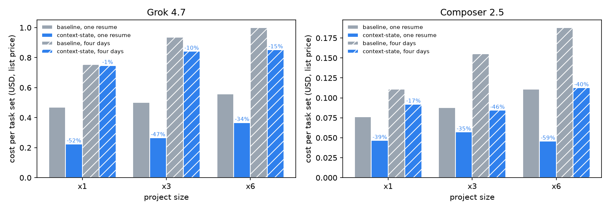
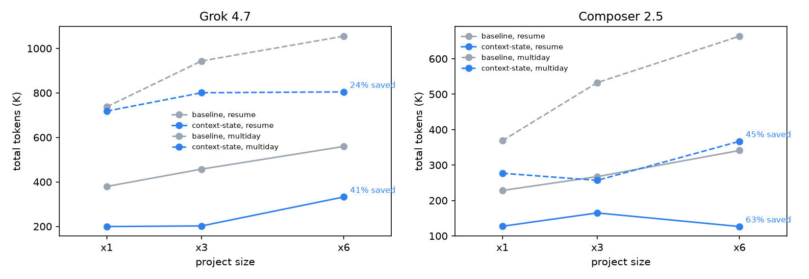
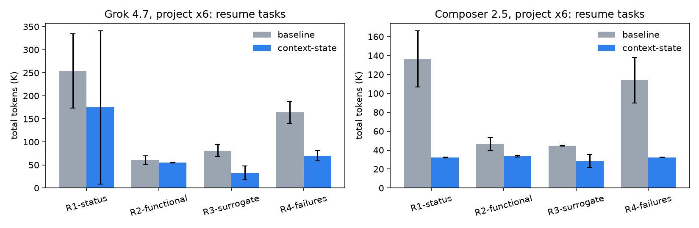
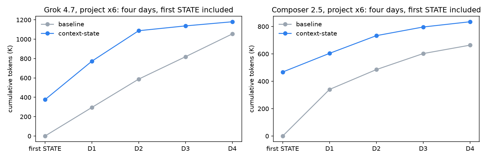

Totals are sums of per-task means; savings are relative to baseline. Dollar costs use the Cursor list prices in `benchmark/prices.json`.

| model | project size | suite | baseline tokens | context-state tokens | token saving | cost (baseline / context-state) | cost saving | facts correct (baseline / context-state) | runs per task |
|---|---|---|---|---|---|---|---|---|---|
| Grok 4.7 | x1 | resume | 379.6K | 199.4K | 47% | $0.469 / $0.225 | 52% | 100% / 100% | 3 |
| Grok 4.7 | x1 | multiday | 737.2K | 718.0K | 3% | $0.755 / $0.747 | 1% | 100% / 100% | 3 |
| Grok 4.7 | x3 | resume | 457.4K | 202.1K | 56% | $0.500 / $0.266 | 47% | 100% / 98% | 3 |
| Grok 4.7 | x3 | multiday | 943.6K | 800.6K | 15% | $0.935 / $0.842 | 10% | 100% / 100% | 3 |
| Grok 4.7 | x6 | resume | 559.4K | 332.3K | 41% | $0.557 / $0.368 | 34% | 100% / 100% | 3 |
| Grok 4.7 | x6 | multiday | 1054.8K | 804.5K | 24% | $1.000 / $0.852 | 15% | 100% / 100% | 3 |
| Composer 2.5 | x1 | resume | 228.3K | 127.3K | 44% | $0.076 / $0.047 | 39% | 100% / 100% | 3 |
| Composer 2.5 | x1 | multiday | 368.9K | 276.8K | 25% | $0.111 / $0.092 | 17% | 100% / 100% | 3 |
| Composer 2.5 | x3 | resume | 267.4K | 164.9K | 38% | $0.088 / $0.057 | 35% | 100% / 100% | 3 |
| Composer 2.5 | x3 | multiday | 532.7K | 256.8K | 52% | $0.155 / $0.084 | 46% | 100% / 100% | 3 |
| Composer 2.5 | x6 | resume | 341.1K | 126.5K | 63% | $0.111 / $0.046 | 59% | 100% / 100% | 3 |
| Composer 2.5 | x6 | multiday | 663.7K | 367.0K | 45% | $0.188 / $0.113 | 40% | 100% / 100% | 3 |

- Grok 4.7 is `grok-4.7:context=256k,reasoning_effort=high,fast=false`, priced as Grok 4.7.
- Composer 2.5 is `composer-2.5:fast=false`, priced as Composer 2.5.

One-time cost of writing the first STATE files:

- Grok 4.7 x1: bootstrap 842.5K tokens, repaid after about 18.7 resumes (45.0K saved per resume); in dollars $0.765 once, $0.061 saved per resume, repaid after about 12.5 resumes.
- Grok 4.7 x3: bootstrap 848.9K tokens, repaid after about 13.3 resumes (63.8K saved per resume); in dollars $0.808 once, $0.059 saved per resume, repaid after about 13.8 resumes.
- Grok 4.7 x6: bootstrap 375.8K tokens, repaid after about 6.6 resumes (56.8K saved per resume); in dollars $0.229 once, $0.047 saved per resume, repaid after about 4.8 resumes.
- Composer 2.5 x1: bootstrap 242.5K tokens, repaid after about 9.6 resumes (25.3K saved per resume); in dollars $0.071 once, $0.007 saved per resume, repaid after about 9.5 resumes.
- Composer 2.5 x3: bootstrap 369.9K tokens, repaid after about 14.4 resumes (25.6K saved per resume); in dollars $0.100 once, $0.008 saved per resume, repaid after about 13.0 resumes.
- Composer 2.5 x6: bootstrap 467.6K tokens, repaid after about 8.7 resumes (53.7K saved per resume); in dollars $0.129 once, $0.016 saved per resume, repaid after about 7.9 resumes.

Per-task results

**Grok 4.7, project x1, single resume in a new chat**

| task | baseline tokens | context-state tokens | token saving | facts correct (baseline / context-state) |
|---|---|---|---|---|
| R1-status | 164.4K ± 40.1K | 68.3K ± 54.2K | 58% | 100% / 100% |
| R2-functional | 34.5K ± 0.1K | 39.6K ± 2.1K | -15% | 100% / 100% |
| R3-surrogate | 34.1K ± 1.5K | 33.3K ± 7.7K | 2% | 100% / 100% |
| R4-failures | 146.6K ± 2.3K | 58.2K ± 9.8K | 60% | 100% / 100% |

**Grok 4.7, project x1, four days, one new chat per day**

| task | baseline tokens | context-state tokens | token saving | facts correct (baseline / context-state) |
|---|---|---|---|---|
| D1 | 143.8K ± 38.7K | 235.1K ± 110.1K | -63% | 100% / 100% |
| D2 | 193.2K ± 96.4K | 405.8K ± 44.0K | -110% | 100% / 100% |
| D3 | 306.1K ± 69.6K | 35.3K ± 8.7K | 88% | 100% / 100% |
| D4 | 94.0K ± 16.8K | 41.9K ± 1.2K | 55% | 100% / 100% |

**Grok 4.7, project x3, single resume in a new chat**

| task | baseline tokens | context-state tokens | token saving | facts correct (baseline / context-state) |
|---|---|---|---|---|
| R1-status | 179.6K ± 31.1K | 67.7K ± 52.4K | 62% | 100% / 100% |
| R2-functional | 57.0K ± 7.7K | 38.2K ± 0.9K | 33% | 100% / 100% |
| R3-surrogate | 38.9K ± 0.1K | 38.1K ± 0.5K | 2% | 100% / 92% |
| R4-failures | 181.9K ± 136.1K | 58.0K ± 5.7K | 68% | 100% / 100% |

**Grok 4.7, project x3, four days, one new chat per day**

| task | baseline tokens | context-state tokens | token saving | facts correct (baseline / context-state) |
|---|---|---|---|---|
| D1 | 246.0K ± 32.1K | 273.3K ± 102.3K | -11% | 100% / 100% |
| D2 | 217.9K ± 10.9K | 383.5K ± 68.1K | -76% | 100% / 100% |
| D3 | 331.4K ± 92.4K | 62.0K ± 27.0K | 81% | 100% / 100% |
| D4 | 148.3K ± 40.0K | 81.9K ± 45.2K | 45% | 100% / 100% |

**Grok 4.7, project x6, single resume in a new chat**

| task | baseline tokens | context-state tokens | token saving | facts correct (baseline / context-state) |
|---|---|---|---|---|
| R1-status | 253.6K ± 80.5K | 174.9K ± 166.0K | 31% | 100% / 100% |
| R2-functional | 60.8K ± 9.2K | 55.4K ± 1.0K | 9% | 100% / 100% |
| R3-surrogate | 81.1K ± 13.4K | 32.6K ± 15.3K | 60% | 100% / 100% |
| R4-failures | 163.8K ± 23.8K | 69.5K ± 10.9K | 58% | 100% / 100% |

**Grok 4.7, project x6, four days, one new chat per day**

| task | baseline tokens | context-state tokens | token saving | facts correct (baseline / context-state) |
|---|---|---|---|---|
| D1 | 294.9K ± 30.7K | 396.8K ± 77.4K | -35% | 100% / 100% |
| D2 | 292.9K ± 20.5K | 315.2K ± 81.3K | -8% | 100% / 100% |
| D3 | 231.3K ± 74.7K | 49.8K ± 19.1K | 78% | 100% / 100% |
| D4 | 235.8K ± 37.0K | 42.7K ± 7.6K | 82% | 100% / 100% |

**Composer 2.5, project x1, single resume in a new chat**

| task | baseline tokens | context-state tokens | token saving | facts correct (baseline / context-state) |
|---|---|---|---|---|
| R1-status | 75.2K ± 14.4K | 21.0K ± 0.1K | 72% | 100% / 100% |
| R2-functional | 45.7K ± 1.8K | 41.0K ± 6.6K | 10% | 100% / 100% |
| R3-surrogate | 29.6K ± 0.0K | 20.5K ± 0.2K | 31% | 100% / 100% |
| R4-failures | 77.8K ± 19.4K | 44.8K ± 0.8K | 42% | 100% / 100% |

**Composer 2.5, project x1, four days, one new chat per day**

| task | baseline tokens | context-state tokens | token saving | facts correct (baseline / context-state) |
|---|---|---|---|---|
| D1 | 128.0K ± 13.5K | 106.1K ± 7.6K | 17% | 100% / 100% |
| D2 | 107.5K ± 24.2K | 110.6K ± 11.0K | -3% | 100% / 100% |
| D3 | 78.4K ± 7.5K | 27.5K ± 6.4K | 65% | 100% / 100% |
| D4 | 55.0K ± 15.9K | 32.5K ± 1.0K | 41% | 100% / 100% |

**Composer 2.5, project x3, single resume in a new chat**

| task | baseline tokens | context-state tokens | token saving | facts correct (baseline / context-state) |
|---|---|---|---|---|
| R1-status | 91.7K ± 9.4K | 41.2K ± 18.4K | 55% | 100% / 100% |
| R2-functional | 40.0K ± 8.9K | 57.9K ± 0.3K | -45% | 100% / 100% |
| R3-surrogate | 36.9K ± 0.1K | 20.4K ± 0.1K | 45% | 100% / 100% |
| R4-failures | 98.8K ± 0.8K | 45.3K ± 0.4K | 54% | 100% / 100% |

**Composer 2.5, project x3, four days, one new chat per day**

| task | baseline tokens | context-state tokens | token saving | facts correct (baseline / context-state) |
|---|---|---|---|---|
| D1 | 197.9K ± 45.6K | 109.4K ± 16.5K | 45% | 100% / 100% |
| D2 | 137.6K ± 31.2K | 91.5K ± 6.8K | 34% | 100% / 100% |
| D3 | 108.9K ± 34.9K | 23.8K ± 6.3K | 78% | 100% / 100% |
| D4 | 88.2K ± 47.6K | 32.3K ± 0.9K | 63% | 100% / 100% |

**Composer 2.5, project x6, single resume in a new chat**

| task | baseline tokens | context-state tokens | token saving | facts correct (baseline / context-state) |
|---|---|---|---|---|
| R1-status | 136.3K ± 29.7K | 32.3K ± 0.4K | 76% | 100% / 100% |
| R2-functional | 46.3K ± 7.0K | 33.5K ± 0.9K | 28% | 100% / 100% |
| R3-surrogate | 44.7K ± 0.6K | 28.4K ± 6.9K | 37% | 100% / 100% |
| R4-failures | 113.8K ± 24.1K | 32.4K ± 0.2K | 72% | 100% / 100% |

**Composer 2.5, project x6, four days, one new chat per day**

| task | baseline tokens | context-state tokens | token saving | facts correct (baseline / context-state) |
|---|---|---|---|---|
| D1 | 340.3K ± 78.6K | 136.3K ± 36.4K | 60% | 100% / 100% |
| D2 | 145.0K ± 50.1K | 129.2K ± 9.6K | 11% | 100% / 100% |
| D3 | 116.9K ± 24.6K | 63.3K ± 28.4K | 46% | 100% / 100% |
| D4 | 61.4K ± 6.7K | 38.3K ± 8.5K | 38% | 100% / 100% |

